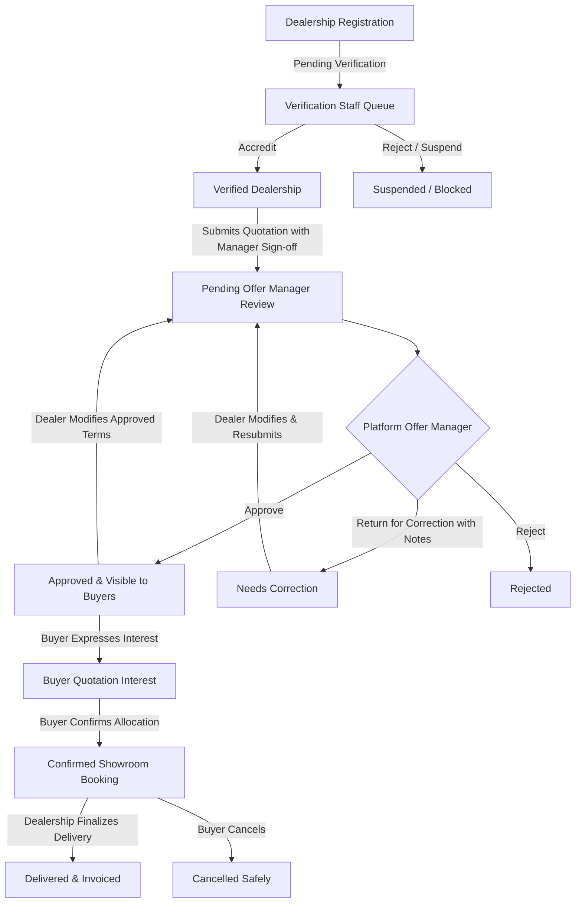

# GroupBuy Cars — AI Deal Coach for Collective Car Buying

**Tagline:** More Buyers. More Bargaining Power. Better Decisions.  
**Hackathon Theme:** Theme 2 — Reimagine Everyday Life: Make the Complex Simple.  
**Pilot Demo City:** Hyderabad, Telangana, India.


## 🚗 The Problem

Buying a new car as an individual in India is stressful, fragmented, and opaque:
- Solo buyers negotiate for a single car with **zero volume bargaining leverage**.
- Dealerships disguise actual margins behind confusing bundles: inflated retail accessory packs, mandatory in-house insurance policies, and captive vehicle finance tie-ins.
- Comparing quotes across multiple showrooms (Jubilee Hills, Somajiguda, Gachibowli) requires days of legwork with no objective clarity.

## ⚡ The Solution

**GroupBuy Cars** turns scattered individual buyer demand into organized collective negotiating power, and turns confusing dealership quotes into one clear, AI-analyzed decision.

1. **Demand Aggregation:** Buyers interested in the same car model in the same city pool into volume campaigns.
2. **Dealership Competition:** Dealerships bid for the entire batch with structured fleet quotations.
3. **AI Offer Analyzer & Deal Coach:** AI decomposes dealer quotes, calculates pure cash invoice savings, flags accessory markups, and answers customer questions with grounded financial advice.
4. **Deterministic Rupee Engine:** Pure cash discount subtraction with strict isolation of non-cash accessories.
5. **Multi-Role Governance System:** Strict Role-Based Access Control (RBAC) across 5 distinct personas with complete operational separation of duties.


## 👥 5 Dedicated Role Personas & Governance Architecture

GroupBuy Cars implements strict separation of duties across 5 distinct roles:

### 1. Buyer (`buyer`)
- **Persona:** Rahul Sharma (`user-buyer-rahul`)
- **Preferences:** Car model, fuel, transmission, budget, city, purchase timeline.
- **Actions:**
  - Search & match existing demand pools via the interactive **Find My Car Group** engine.
  - Create custom car group pools if no matching group exists.
  - Join a group with zero financial commitment (pooling collective leverage).
  - Express interest in an approved quotation.
  - Confirm booking intent for a specific showroom without online payment.
  - Cancel booking intent anytime with zero penalty.
  - **Strict Access Boundary:** Cannot submit, edit, or approve dealership quotations.

### 2. Dealership Owner / General Manager (`dealer`)
- **Personas:**
  - Rajesh Varma (Fleet GM, KUN United Hyundai - `dealer-a-kun`)
  - Priya Sharma (Corporate GM, Talwar Hyundai - `dealer-b-talwar`)
- **Actions:**
  - Browse active demand pools in Crores across regional hubs.
  - Submit structured quotations with branch selection, cash discount, mandatory vs optional accessories, warranty, delivery timeline, and minimum booking quotas.
  - **Showroom Manager Authorization Confirmation:** Required checkbox before submitting quotation.
  - **Strict Cross-Dealer Isolation:** Dealer B is blocked with HTTP 403 when attempting to edit Dealer A quotations.
  - **Approval Invalidation:** Modifying an approved quotation automatically un-publishes it from buyer view and reverts it to `pending_review` (incrementing version).

### 3. Verification Staff (`verification_staff`)
- **Persona:** Ananya Sen (Senior Dealership Accreditation Lead)
- **Actions:**
  - Accredit franchise dealerships: inspect GSTIN, OEM franchise agreement proof, and showroom principal contact.
  - Approve, Reject, or Suspend dealership accounts.
  - Suspending a dealership automatically demotes all its live offers.
  - **Strict Access Boundary:** Verification Staff cannot review or approve commercial bids.

### 4. Platform Offer Manager (`offer_manager`)
- **Persona:** Vikram Malhotra (Platform Commercial Offer Manager)
- **Actions:**
  - Review quotation queue: Pending Review, Needs Correction, Approved & Live, Rejected.
  - **Accreditation Prerequisite:** Cannot approve an offer if the submitting dealership is pending KYC or suspended.
  - **Mandatory Reason:** Returning for correction (`needs_correction`) or rejecting requires specific feedback instructions for the dealer.
  - **Strict Access Boundary:** Dealership owners cannot approve their own offers as platform reviewers. Offer Managers cannot accredit dealerships.

### 5. Super Administrator (`super_admin`)
- **Persona:** Chief Platform Administrator
- **Actions:**
  - Full system oversight across all 7 operational tabs: Offer Review Queue, Dealership Accreditation, Group Capacities, Showroom Bookings Pipeline, Registered Buyers, Staff RBAC Matrix, and Audit Trail.
  - Manage campaign lifecycle: mark groups as `completed` or `closed` to stop new buyer registrations while preserving historical records.


## 📊 The 4 Distinct Platform Counters

GroupBuy Cars never confuses demand interest with final purchases:
1. **Joined Group Members:** Total prospective buyers pooling demand in the group (e.g. 17 / 20 Creta buyers).
2. **Approved Showroom Bids:** Live competing quotations from accredited dealerships reviewed by Offer Managers.
3. **Confirmed Booking Intents:** Buyers who explicitly selected a specific showroom's quotation for vehicle allotment.
4. **Finalized Deliveries:** Showroom vehicle handovers completed upon final invoice.


## 🔄 Offer Approval & Governance Lifecycle




## 🧪 Automated Test Suite — 18/18 Requirements Verified

A comprehensive automated test suite testing all 18 requirements is included in `test-rbac.mjs`:

```bash
# Run the test suite against the running local server
node test-rbac.mjs
```

### Verified Test Results (18 Passed, 0 Failed):
- ✅ **REQ 1:** Buyer session initializes with distinct buyer persona and profile preferences.
- ✅ **REQ 2:** Buyer view strictly filters out unapproved bids and unverified dealerships.
- ✅ **REQ 3:** Buyers are strictly forbidden from submitting dealership quotations (`HTTP 403`).
- ✅ **REQ 4:** Buyers are strictly forbidden from editing dealership quotations (`HTTP 403`).
- ✅ **REQ 5:** New dealership registration begins strictly in `pending` verification status.
- ✅ **REQ 6:** Dealerships and buyers cannot self-verify dealership accounts (`HTTP 403`).
- ✅ **REQ 7:** Authorized Verification Staff can accredit and verify dealership accounts (`HTTP 200`).
- ✅ **REQ 8:** Dealership owners cannot approve quotations as platform reviewers (`HTTP 403`).
- ✅ **REQ 9:** Offer Manager approval is blocked if dealership is not accredited (KYC Pre-requisite `HTTP 400`).
- ✅ **REQ 10:** Dealership quotations require explicit showroom manager authorization confirmation (`HTTP 400`).
- ✅ **REQ 11:** Dealer B cannot edit Dealer A quotations (Cross-Dealer Isolation `HTTP 403`).
- ✅ **REQ 12:** Modifying approved quote invalidates approval, reverts to `pending_review`, and bumps version.
- ✅ **REQ 13:** Returning offer for correction requires mandatory specific explanation notes (`HTTP 400` if missing).
- ✅ **REQ 14:** Offer Manager can approve verified dealer quote, making it live for buyers.
- ✅ **REQ 15:** Buyer can register interest in an approved quotation without payment.
- ✅ **REQ 16:** Buyer confirms booking intent for chosen dealership showroom allocation.
- ✅ **REQ 17:** Buyer can cancel showroom booking intent with zero penalty.
- ✅ **REQ 18:** Staff can close or complete campaigns to lock memberships while preserving historical records.


## 🚀 How to Run Locally

```bash
# 1. Install dependencies (if not already installed)
npm install

# 2. Run Next.js development server
npm run dev

# 3. Run automated RBAC test suite
node test-rbac.mjs

# 4. Open in browser
http://localhost:3000
```

### 🧭 Key Routes to Explore:
- **Homepage:** `http://localhost:3000` (Find My Car Group modal, 17/20 Creta banner, live tiers)
- **Creta Pilot Pool:** `http://localhost:3000/campaigns/hyundai-creta-sxo-at` (The 4 counters, AI Deal Coach drawer, showroom quotes)
- **Buyer Portal:** `http://localhost:3000/buyer` (Vehicle preferences, active groups, confirmed showroom bookings)
- **Dealer Portal:** `http://localhost:3000/dealer` (Dealership KYC badge, branches, submit structured bids, bookings pipeline)
- **Admin & Governance Dashboard:** `http://localhost:3000/admin` (7 tabs: Quotation Review Queue, Dealership KYC, Capacities, Showroom Bookings, RBAC Matrix, Audit Trail)


## 🗄️ Database & Row Level Security (RLS)

A complete production PostgreSQL schema with Row Level Security is provided in `src/lib/supabase/schema.sql`. It defines:
- Tables: `user_profiles`, `dealership_accounts`, `dealership_branches`, `campaigns`, `campaign_members`, `dealer_offers`, `buyer_bookings`, `offer_audit_logs`.
- Database trigger: `handle_dealer_offer_update()` automatically demotes edited approved offers to `pending_review`.
- RLS Policies ensuring buyers only see approved offers from verified dealerships, dealers only edit their own showroom bids, and staff manage accreditation and moderation.

# group-by-cars


